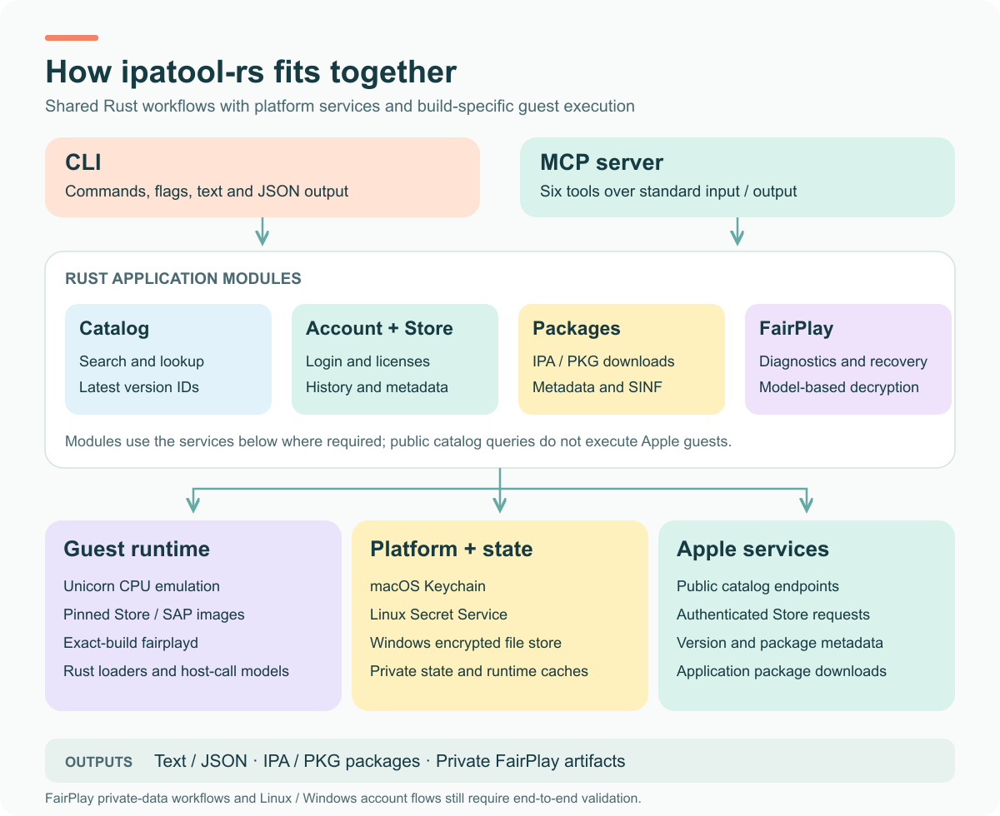

# ipatool-rs

App Store search, account management, IPA / PKG downloads, and FairPlay tooling in Rust.

[](https://github.com/everettjf/ipatool-rs/releases)
[](LICENSE)
[](#platforms)

Built on the work of [ipatool](https://github.com/majd/ipatool), [UnfairPlay](https://github.com/DrWhax/unfairplay), and their contributors. The combined Go project `ipatool-fairplay` is the direct reference for this port. Thank you to the original authors and maintainers.

> **Experimental Rust rewrite.** This project was created to use otherwise-unused Codex quota and explore whether Codex could carry a substantial port through implementation, testing, and release. For practical use, prefer the original projects. Full parity remains under validation; see [known limitations](#known-limitations).

[Install](#install) · [Quick start](#quick-start) · [Commands](#commands) · [Architecture](#architecture) · [MCP](#mcp) · [Development](#development) · [Documentation](#documentation)

## Features

| Area | Capabilities |
| --- | --- |
| Public catalog | Search applications, look up details, and find the latest external version ID without signing in. |
| Account and Store | Sign in, inspect or revoke saved credentials, obtain free-app licenses, and query purchases and version metadata. |
| Packages | Download entitled IPA or Mac PKG packages, with package metadata and SINF handling. |
| MCP | Expose six App Store tools to compatible clients over standard input and output. |
| FairPlay | Diagnostics, collection, recovery, and model-based decryption command paths. Private-data flows remain unverified end to end. |

## Platforms

The following release targets are available:

| Operating system | Architecture | Distribution | Current scope |
| --- | --- | --- | --- |
| macOS | Apple Silicon / arm64 | Homebrew or `.tar.gz` | Developer ID signed and notarized; selected real-account and package flows checked. |
| Linux | x86_64 | `.tar.gz` | Experimental; native CI and public catalog checks pass. Real account and package flows remain unverified. |
| Windows | x86_64 | `.zip` | Experimental; native CI and public catalog checks pass. Real account and package flows remain unverified. |

macOS x86_64, Linux ARM64, Windows ARM64, and iOS runtime releases are deferred. The platforms accepted by `--platform` select an App Store offer; they do not expand the host operating systems supported by this release.

## Install

### Homebrew on Apple Silicon macOS

```sh
brew tap everettjf/tap
brew install everettjf/tap/ipatool-rs
ipatool-rs --version
```

For an existing installation, use `brew upgrade everettjf/tap/ipatool-rs`.

### Release archives

Download the matching archive and its companion `.sha256` file from [GitHub Releases](https://github.com/everettjf/ipatool-rs/releases/latest):

| Platform | Archive |
| --- | --- |
| macOS arm64 | [Latest release](https://github.com/everettjf/ipatool-rs/releases/latest) — choose `*-macos-arm64.tar.gz` |
| Linux x86_64 | [Latest release](https://github.com/everettjf/ipatool-rs/releases/latest) — choose `*-linux-x86_64.tar.gz` |
| Windows x86_64 | [Latest release](https://github.com/everettjf/ipatool-rs/releases/latest) — choose `*-windows-x86_64.zip` |

Verify the checksum, extract the archive, and put the directory containing `ipatool-rs` on your `PATH`. On Windows, the executable is `ipatool-rs.exe`. The installed command is **`ipatool-rs`** and can coexist with the original `ipatool`.

<details>
<summary>Checksum verification</summary>

Run the check from the directory containing both the archive and its checksum file. Keep only the release you want to verify in that directory; the wildcards below match its downloaded filenames.

macOS:

```sh
shasum -a 256 -c ipatool-rs-*-macos-arm64.tar.gz.sha256
```

Linux:

```sh
sha256sum -c ipatool-rs-*-linux-x86_64.tar.gz.sha256
```

Windows PowerShell: compare the resulting hash with the companion `.sha256` file.

```powershell
Get-FileHash .\ipatool-rs-*-windows-x86_64.zip -Algorithm SHA256
```

</details>

## Quick start

All usage examples assume that the installed `ipatool-rs` command is on your `PATH`.

### Search without an account

```sh
ipatool-rs search ScriptWidget --platform macos --country US --limit 5
ipatool-rs lookup --app-id 1555600758 --platform macos --country US
ipatool-rs latest-version-id --app-id 1555600758 --platform macos --country US
```

Public queries default to the US storefront. Use `--country` to select another storefront and `--format json` for machine-readable output. Catalog requests support iPhone, iPad, Apple TV, Apple Watch, macOS, and visionOS offers.

### Sign in and download an owned application

```sh
ipatool-rs auth login
ipatool-rs auth info
ipatool-rs list-purchases --platform macos --max-results 2
ipatool-rs download --app-id 1555600758 --platform macos --output ./ScriptWidget.pkg
```

Enter the Apple ID password and any verification code at the interactive prompts. `purchase` obtains a license for a free application; `download` requires the appropriate account entitlement.

Native Mac applications such as ScriptWidget download as PKGs. A compatible iPhone or iPad application offered on Apple Silicon Mac can return an IPA instead. Use `--platform iphone` to request an iPhone offer when the account is entitled to it. Package format follows the selected Store offer.

## Commands

| Task | Commands |
| --- | --- |
| Search and inspect public catalog entries | `search`, `lookup`, `latest-version-id` |
| Manage saved account credentials | `auth login`, `auth info`, `auth revoke` |
| Obtain a free-app license | `purchase` |
| Query purchases and versions | `list-purchases`, `list-versions`, `get-version-metadata` |
| Download an application package | `download` |
| Start the MCP server | `mcp` |
| Inspect and process FairPlay data | `fairplay-doctor`, `fairplay-enroll`, `fairplay-decrypt` |
| Generate shell completions | `completion` |

Use `ipatool-rs --help` or a command's `--help` for its available options.

## Architecture



The CLI and MCP server share the same Rust application modules. Public catalog queries use the catalog client directly and do not need a saved account or Apple guest execution.

Selected Store and SAP signing paths load pinned Apple framework images and execute ARM64 guest code through Unicorn. Rust supplies the image loaders, execution control, and host-call models. The program does not launch a separate Go, Python, or Swift executable; it still depends on the corresponding Apple guest code and the Unicorn runtime for these paths.

FairPlay processing uses exact-build `fairplayd` images, startup profiles, and matched private inputs. The bundled startup profiles do not establish support for arbitrary system builds. Private enrollment and decryption still need end-to-end validation.

The editable diagram is available as [SVG](docs/images/architecture.svg). Implementation and parity evidence are recorded in [PORTING.md](docs/PORTING.md).

## Credentials and local state

| Host | Default credential store |
| --- | --- |
| macOS | Apple Keychain; interactive commands may request authorization. |
| Linux | Secret Service when available, with encrypted file storage as a fallback. |
| Windows | Encrypted file storage. |

Use `--file-keychain` to select encrypted file storage explicitly:

```sh
ipatool-rs --file-keychain auth login
```

The file store prompts for a separate passphrase. `IPATOOL_STATE_DIR` can select an absolute private directory for isolated account state and cookies. Keep credentials, cookies, downloaded packages, and private captures outside the repository.

`--non-interactive` disables terminal prompts and Keychain authorization dialogs. A command that needs approval or missing credentials returns an error so an unattended client can handle it.

## MCP

Start the stdio server with:

```sh
ipatool-rs mcp --non-interactive
```

A typical client configuration is:

```json
{
  "mcpServers": {
    "ipatool-rs": {
      "command": "ipatool-rs",
      "args": ["mcp", "--non-interactive"]
    }
  }
}
```

Use an absolute executable path if the client does not inherit your shell's `PATH`.

Available tools: `search_apps`, `list_purchases`, `list_app_versions`, `get_version_metadata`, `purchase_app`, and `download_app`. Public search does not require an account; authenticated tools use saved account state.

<details>
<summary>Encrypted file storage with MCP</summary>

MCP uses standard input for its protocol, so it cannot prompt for the file-store passphrase. Supply `--keychain-passphrase-file /absolute/private/path` with the MCP command. On macOS and Linux, restrict the file to its owner with mode `0600`. Remove the file after use and keep both Apple ID passwords and file-store passphrases out of process arguments and client configuration files.

</details>

## Known limitations

- Linux and Windows real-account login, credential-store migration, and package workflows have not been validated end to end.
- macOS still needs a real 2FA challenge, successful expired-token recovery, and complete interactive default-Keychain login and revoke checks. Some authenticated MCP paths also remain unverified.
- Private FairPlay enrollment and real IPA decryption require matched inputs and a supported build; they remain unverified end to end.
- Automatic generation of a new FairPlay startup profile during collection is not implemented in the release.

See [TODO.md](docs/TODO.md) for actionable remaining work and [PORTING.md](docs/PORTING.md) for the evidence behind each status. The release version does not imply full parity with the reference projects.

## Development

Use the stable Rust toolchain with `rustfmt` and `clippy`. Run the repository checks before submitting Rust changes:

```sh
cargo fmt --check
cargo test --all-targets --quiet
cargo clippy --all-targets -- -D warnings
```

Some checks require cached Apple framework images or explicitly supplied private data. See the [porting record](docs/PORTING.md) for their prerequisites.

### Build for Apple Silicon macOS

```sh
scripts/build-macos.sh --arm64
```

The script writes an ad hoc signed `target/release/ipatool-macos-arm64`. To install a local development build under the usual command name:

```sh
mkdir -p "$HOME/.local/bin"
install -m 755 target/release/ipatool-macos-arm64 "$HOME/.local/bin/ipatool-rs"
export PATH="$HOME/.local/bin:$PATH"
ipatool-rs --version
```

Add the `PATH` setting to your shell configuration if needed. This development signature is ad hoc; signed and notarized release packaging follows [RELEASING.md](docs/RELEASING.md).

### Native Linux and Windows builds

```sh
cargo build --release --locked
```

Cargo's internal binary name is `ipatool` (`ipatool.exe` on Windows). Release packaging installs it as `ipatool-rs` (`ipatool-rs.exe`). Use the installed name for the usage examples above.

## Documentation

| Document | Contents |
| --- | --- |
| [PORTING.md](docs/PORTING.md) | Reference parity, implementation notes, and verification evidence. |
| [TODO.md](docs/TODO.md) | Remaining validation and implementation work. |
| [RELEASING.md](docs/RELEASING.md) | Packaging, signing, notarization, CI releases, and Homebrew updates. |
| [STARTUP_PROFILE_EXPORT.md](docs/STARTUP_PROFILE_EXPORT.md) | Design for the unfinished startup-profile export feature. |

[Project website](https://xnu.app/ipatool-rs/) · [Releases](https://github.com/everettjf/ipatool-rs/releases) · [Issues](https://github.com/everettjf/ipatool-rs/issues)

## License and attribution

The project is distributed under the [MIT License](LICENSE), matching [ipatool](https://github.com/majd/ipatool) and [UnfairPlay](https://github.com/DrWhax/unfairplay). The adapted DarkPhoenix recovery component retains its Apache-2.0 license and attribution; see [NOTICE](NOTICE) and [LICENSE-DARKPHOENIX.txt](licenses/LICENSE-DARKPHOENIX.txt).
